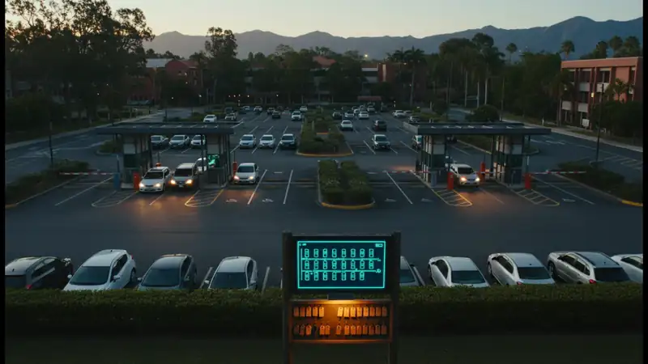

<p align="center">
  <a href="https://pablomanjarres.com/oss/vibethon-hackathon"></a>
</p>

<h1 align="center">Hedge Parking</h1>

<p align="center"><em>Two campus gates, one parking lot, and a fair turn for every car. A rush-hour parking and valet app built in one day at the EAFIT Vibethon.</em></p>

<p align="center">
  
  
  
  
  
  
  <a href="https://pablomanjarres.com/portfolio/projects/vibethon-hackathon"></a>
  <a href="https://pablomanjarres.com/oss/vibethon-hackathon"></a>
</p>

<p align="center"></p>

At rush hour two EAFIT gates, Las Vegas and Regional, fill the same parking lot and nobody coordinates them. A stall can be promised twice, one gate can starve the other, and students wait in line without knowing how long while their first class starts. Hedge Parking gives the driver, both gates, the valets and the parking office one shared state. Drivers see their place in line and an estimated wait, reserve the free stall when it is their turn, or hand the keys to a valet for a numbered ticket and walk to class. Try it in the browser at [pablomanjarres.com/portfolio/vibethon-hackathon/demo](https://pablomanjarres.com/portfolio/vibethon-hackathon/demo). The interface is in Spanish, as the challenge required.

## Highlights

- **One owner for every state change.** `src/parqueadero/motor.ts` runs each of 17 command types on a copy of the state. When it refuses, it returns a reason in Spanish and the state stays as it was.
- **A fairness rule across both gates.** `src/parqueadero/asignador.ts` gives the next free stall to the car that arrived first at either entrance. On a tie it goes to the gate that has received fewer stalls, and only the gate whose turn it is can assign.
- **Waits from what the lot is actually doing.** `src/parqueadero/espera.ts` places each car in the combined order of both gates and turns the gaps between the last 8 stall movements into a minute range. With too little data it says so instead of inventing a number.
- **Allowed transitions only.** `src/parqueadero/transiciones.ts` allows 4 stall moves (free, reserved, occupied) and 4 valet moves. Anything else is refused with its reason.
- **One store behind the views.** `src/routes.ts` lists the driver, gate, valet and office views plus a phone view, mockups, a step-by-step simulator and a four-panel flow. Every view except the static mockups reads `src/parqueadero/tienda.ts`, so they cannot contradict each other.
- **Built and logged in one day.** 403 commits and 74 merged pull requests on October 30, 2026, 27 Vitest checks, and 26 typed prompts recorded verbatim in `docs/prompting.raw.md`.

## How it works

```text
src/
  parqueadero/            # the engine: the only code that changes state
    motor.ts              # ejecutar(estado, comando): copy, apply, or refuse with a reason
    comandos/             # lines and stalls, valet, payment and exit
    transiciones.ts       # allowed stall and valet moves
    asignador.ts          # who gets the next stall, across both gates
    espera.ts             # estimated wait per car
    escenario.ts          # validates the scenario JSON and builds the seed
    escenarios/demo.json  # the one seed: 12 stalls, 2 gates, 8 valets each
    lecturas/             # what each view reads: driver, gate, valet, office
    simulacion.ts         # scripted arrivals and departures from the scenario
    tienda.ts             # shared store, saved to localStorage
  vistas/                 # conductor, porteria, valet, oficina, telefono, simulador, flujo
  ui/                     # shared components and design tokens
scripts/                  # npm run foto, shots and an error/contrast sweep
docs/                     # brief, direction, QA matrix, demo script, prompt log
```

Every button sends a command to `motor.ts`. The engine works on a copy, checks the transition tables and the split rule, and either returns the new state with a readable event or refuses with a reason. The views never write state themselves. They call small read functions in `lecturas/` that already include the message to show and the next step, which keeps the driver, gate, valet and office screens consistent.

The scenario file is the only input. Maps, capacities, starting conditions and events come from JSON, so the organizers' data can replace `demo.json` without touching code. `escenario.ts` validates it on load and says what is wrong if something does not add up.

## What's inside

| Path | What it is |
|---|---|
| `src/parqueadero/` | The engine, the split rule, wait estimates, scenario loading and the shared store |
| `src/vistas/conductor/` | Driver: place in line, wait, stall reservation on the map, valet ticket |
| `src/vistas/porteria/` | Gate: each passage, whose turn it is, free stalls, plate search |
| `src/vistas/valet/` | Valet: current service, next step, tickets and the key board |
| `src/vistas/oficina/` | Office: the whole lot live, simulation up to a chosen minute, log, reset |
| `src/vistas/telefono/`, `simulador/`, `flujo/` | Phone view, a step simulator and all four views at once |
| `brand/generar.py` | Builds the Hedge Parking symbol, wordmark and app icon as path-only SVGs |
| `docs/` | Brief, visual direction, design rules, QA matrix, demo script, prompt log and the original Spanish README |

## Tech stack

React 19 · TypeScript 7 · Vite 8 · Vitest 5 · lucide-react · Inter and Newsreader via Fontsource · Playwright for screenshots and sweeps · localStorage for state · Node 22+, npm

## Getting started

```bash
npm install
npm run dev     # http://127.0.0.1:5199/
npm test        # 27 Vitest checks on the split rule, waits and valet flow
npm run foto    # prints the seed: lot, passages, turns and valets
npm run build   # type check plus a static build in dist/
```

Everything is simulated: cameras, plate reads, arrivals, departures and payments. There is no database or backend. State lives in the browser tab, and Reiniciar in the office view returns to the seed. The 12 stalls are an example, not the real capacity. The Spanish write-up of what works and its limits is in [`docs/README.es.md`](docs/README.es.md).

## License

MIT.

---

<p align="center">
  <a href="https://pablomanjarres.com/oss/vibethon-hackathon">Landing</a> ·
  <a href="https://pablomanjarres.com/portfolio/projects/vibethon-hackathon">Portfolio write-up</a> ·
  Built by Pablo Manjarres
</p>
