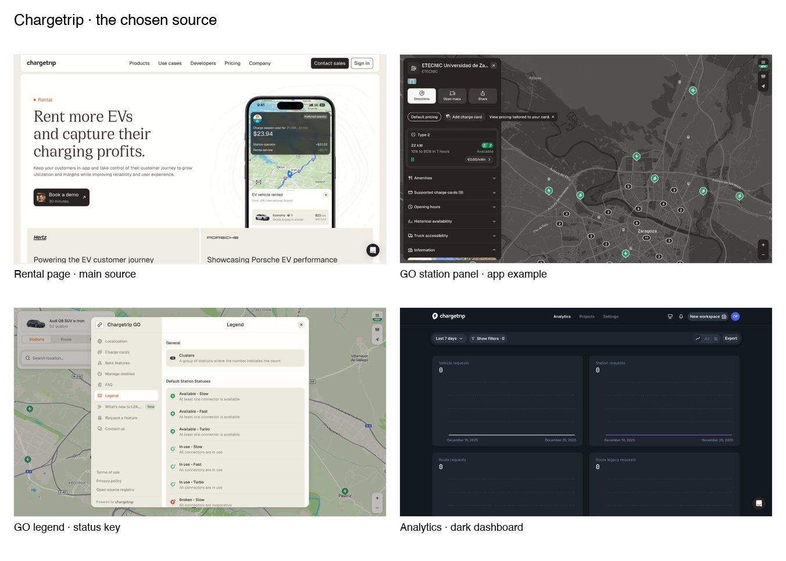
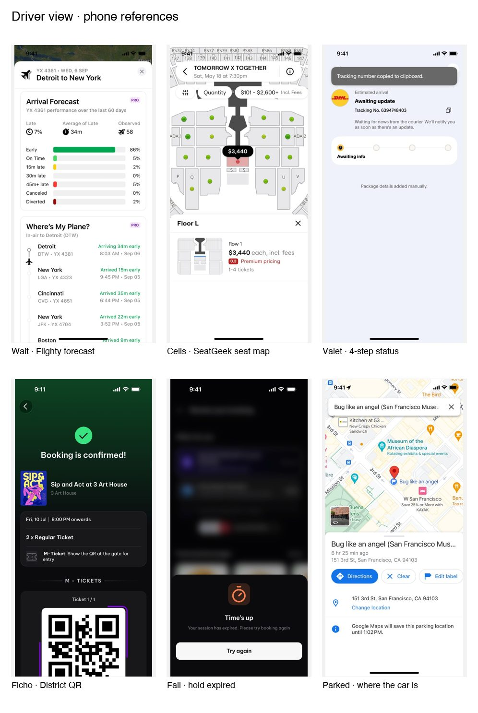
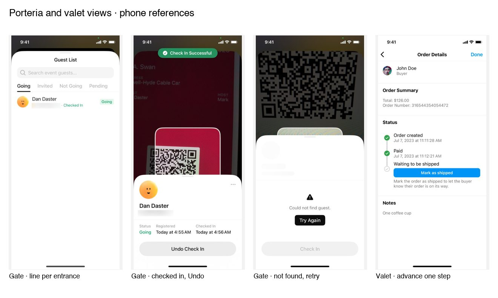
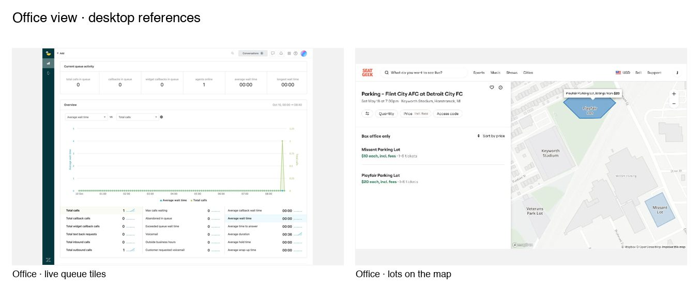

# Inspiration: EAFIT parking

The look follows Chargetrip: the rental page is the main source, and the Chargetrip GO station panel and the SeatGeek parking page show how the app screens should read. The map stays limited to the EAFIT parking lot.

The screens below cover what those three pages do not show: the driver's wait, the cells, the valet handoff and the ficho, and the porteria, valet and office views. Use them for structure and content only. The look still comes from Chargetrip.

## Chargetrip

| Screen | Use | Refero data |
|---|---|---|
| [Rental page](https://refero.design/pages/f1a3a607-cdec-4361-8226-590419fb0c76) | Main source: canvas, type, buttons, cards | Fonts Geist and Cirka; colors #332E28, #EDC70D, #B05E19, #93A5A9, #FBFBFB |
| [GO station panel](https://refero.design/pages/2c20bab9-b7de-4e52-8b72-061a090f6706) | App example: dark map, docked detail panel, "2 Available" pill, accordions | Font Helvetica Neue; colors #232322, #2C2324, #54524D, #6C6967, #EAE9E7 |
| [GO legend](https://refero.design/pages/471e7f37-50a9-4d49-9032-0706deb6a84b) | Status key: icon, name and one line per state. Model for libre, reservada, ocupada | |
| [Analytics](https://refero.design/pages/4abd4a1b-821a-43a8-a8d6-114251f8cbde) | Dark dashboard of the same family, for the office view | |

Refero Styles has no Chargetrip entry, so tokens come from these screenshots.

## Driver

| Need | Reference | Adapt |
|---|---|---|
| How long the wait is | [Flighty arrival forecast](https://refero.design/screens/41f11030-3d49-457f-b5d2-3515593f19c9) | The wait as a forecast: minutes now, how often past estimates held, and a timeline of the steps (registration, passage, gate, cell) with a time on each |
| Which cell | [SeatGeek seat map](https://refero.design/screens/cbbdea4e-fc46-4038-9ac7-a3c605ce4fef) | Lot plan with A01 to B06, a dot on each free cell, the assigned cell in a bubble, a sheet with cell and state |
| Valet in progress | [PayPal parcel status](https://refero.design/screens/9d0b1317-b6b1-4974-ac99-d8650daa790e) | One status line and four dots: keys handed over, parked, requested, returned |
| The ficho | [District booking confirmed](https://refero.design/screens/fb0f3128-a4fa-4dcc-acbf-90124f3c5494) | Ficho as a card with its number and a QR, shown at the gate to get the keys back |
| Reservation expired | [District time's up](https://refero.design/screens/1a0f9f2d-196a-406e-8495-927dd18f5fed) | The reserved cell is released: one sentence, one "Try again" |
| Where the car is | [Google Maps saved parking](https://refero.design/screens/98f02442-d5fa-434a-bc56-c5ae4b0351bf) | Cell, time since parking, and until when it is held |

## Porteria and valet

| Need | Reference | Adapt |
|---|---|---|
| Line per entrance | [Luma guest list](https://refero.design/screens/cac2cc1c-5b3f-4ecd-bf7c-f07b11207d51) | Search plus one tab per entrance (Las Vegas, Regional); each row shows plate, time and a state badge |
| Arrival recorded | [Luma check-in](https://refero.design/screens/9fed0a79-39a0-44ac-aef1-fa64005a5ca8) | Success banner, registered and checked-in times, and Undo |
| Plate not found | [Luma guest not found](https://refero.design/screens/8fe24d88-a8cd-4322-8d15-519025d22ed5) | Error sheet with "Try again"; the main action stays disabled until it is resolved |
| Valet advances a service | [Instagram order status](https://refero.design/screens/b361d740-51da-4fba-ae0c-a0e8afce0b41) | Done steps with their times; the next step is the only button, such as "Mark as parked" |

## Office

| Need | Reference | Adapt |
|---|---|---|
| Both lines at once | [Zendesk live queue](https://refero.design/pages/1686eace-68b9-43c8-b6ad-056eca9d35fe) | A row of live tiles per entrance (cars waiting, longest wait, free valets), then the trend below |
| The lot on the map | [SeatGeek parking lots](https://refero.design/pages/bea987b6-775d-4d2b-8a11-80fff2a7a0d3) | Already an app example: list on the left, lot shapes on the map on the right |

## Flow

[District event booking confirmation](https://refero.design/flows/12872): review, paying, waiting for confirmation, confirmed, QR. Success appears only after the payment is confirmed, and waiting has its own screen. Use the same order for the simulated payment and the ficho.
